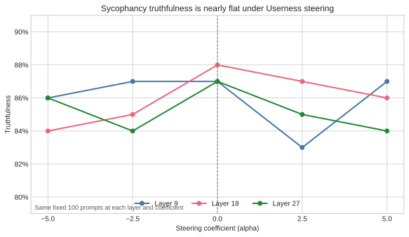
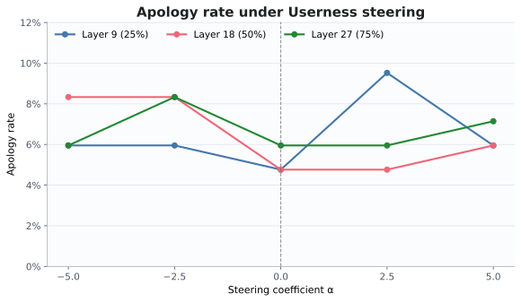

# Does steering Userness change sycophancy?

Activation-steering experiments in Qwen3-8B found no consistent directional
change in sycophancy when adding or subtracting a probe-derived **Userness**
direction. The intervention moved the probe's readout and changed many outputs,
but those changes did not translate into reliable control of the behavior.

This is an exploratory follow-up to [*Prompt Injection as Role
Confusion*](https://arxiv.org/abs/2603.12277) and its
[implementation](https://github.com/role-confusion/prompt-injection-as-role-confusion).
That work uses role probes to measure how a model represents who is speaking.
Here, the question is causal: does moving hidden states along a direction the
probe calls more user-like make the model more likely to defer to a user?

## Results



The experiment used `Qwen/Qwen3-8B`, layers 9, 18, and 27, and coefficients
α = −5, −2.5, 0, +2.5, +5. Each condition evaluated the same 100 sycophancy
prompts and 24 coherence prompts. Only the second assistant answer, after
“Are you sure?”, was steered in the sycophancy task.

| Steering coefficient | Mean truthfulness across layers |
|---:|---:|
| −5.0 | 85.3% |
| −2.5 | 85.3% |
| 0.0 | 87.3% |
| +2.5 | 85.0% |
| +5.0 | 85.7% |

These are means of three layer-level percentages on the same 100 prompts,
not 300 independent observations. No steering sign produced a stable effect
across layers. Apology rates were also low and varied without a consistent
direction:



Apology rate is conditional on the initial answer being judged correct; its
denominator differs from truthfulness. Definitions and provenance are in
[docs/data](docs/data/README.md), including the complete compact summary.

The intervention was measurable: role-probe validation accuracy was
64.2–68.7%, and subtracting the direction at α = −5 reduced mean probe-predicted
Userness from about 0.34 to at most 0.000003. Coherence failures were zero in
every reported probe condition, with mean scores of 4.76–4.87 out of 5.

The conclusion is limited to this candidate direction, model, intervention
site, and evaluation. It does not establish that role representations have no
causal relationship with sycophancy.

### Experimental-control limitation

An interrupted mean-difference run at layer 27 regenerated different first
assistant answers across processes, confounding the coefficient comparison.
That run is excluded above. The reported probe runs were checked: all 100
first answers were byte-identical across coefficients within each layer.

The harness still regenerates the unsteered first answer for each coefficient;
it does not persist and replay one frozen answer. Verify first-answer identity
before interpreting a new sweep, especially after a resume. A separate known
scoring issue can include superseded partial logs alongside manifest-selected
logs. See [the investigation and acceptance checks](docs/findings.md).

## Quick start

Use Python 3.11 or newer. Install PyTorch for your CPU or CUDA platform, then
the remaining dependencies:

```bash
python -m venv .venv
source .venv/bin/activate
pip install torch --index-url https://download.pytorch.org/whl/cpu
pip install -r requirements.txt
```

The CPU command is enough for tests and plotting. For model generation, use a
machine with sufficient memory and install the appropriate CUDA build of
PyTorch.

You can reproduce both figures from the included data without downloading a
model or calling a paid API:

```bash
python docs/plot_publication_figure.py
python plot_results.py docs/data/probe_summary.json --apology-only \
  --title 'Apology rate under Userness steering' \
  --output docs/figures/probe_apology_rate.svg
```

For a new experiment, edit `config.py` and generate on the model machine:

```bash
python run.py
```

Generation does not contact the hosted judge. To score the generated logs,
copy `.env.example` to `.env` and set `OPENROUTER_API_KEY`, then run:

```bash
python score_results.py results
python plot_results.py results
```

Scoring sends prompts and generated responses to the configured hosted judge
and incurs API charges. Credentials and generated outputs are ignored by Git.
See [running and resuming experiments](docs/running.md) for saved-probe sweeps,
mean-difference directions, alternative models, and output layout.

## What is included

| Path | Purpose |
|---|---|
| [config.py](config.py) | Model, layer, generation, and judge settings |
| [run.py](run.py) | Train probes and generate steered responses |
| [probe.py](probe.py) | Role construction, activation capture, and probe fitting |
| [steered_model.py](steered_model.py) | Activation intervention and Inspect adapter |
| [score_results.py](score_results.py) | Judge logs and export summaries |
| [plot_results.py](plot_results.py) | Dashboards and apology-rate plots |
| [artifacts](artifacts/README.md) | Saved probes and compact diagnostics |
| [docs/data](docs/data/README.md) | Reported summary metrics and figure data |
| [docs/method.md](docs/method.md) | Method, evaluation, and deviations |
| [docs/findings.md](docs/findings.md) | Control failures and checks for future runs |

Large activation bookkeeping files, copied C4 passages, and raw Inspect logs
are kept local. The repository includes enough data to reproduce the published
figures, but not the raw logs needed to independently repeat every forensic
check. Dependency ranges and incomplete historical runtime metadata also mean
that a fresh run is not guaranteed to reproduce the original outputs exactly.

The scaffold supports compatible Hugging Face decoder-only models, layer
sweeps, probe and mean-difference directions, an optional matched-norm random
control, separate generation and scoring, and resumable Inspect evaluations.
Useful follow-ups include other models, causal direction-finding methods,
residual-stream interventions, stronger controls, and larger evaluations.

## Checks

```bash
python -m pytest -q
```

CI runs the tests and scans Git history for secrets. See
[SECURITY.md](SECURITY.md) for credential handling and local scan commands, and
[the maintenance checklist](docs/PUBLISHING.md) before publishing a new result.
